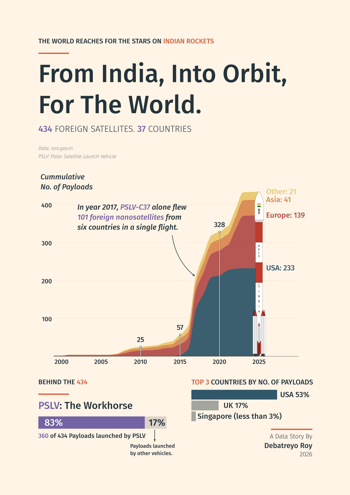

# From India, Into Orbit, For the World

A data visualization of **434 foreign satellites** ISRO launched for **37 countries**. Its Polar Satellite Launch Vehicle (PSLV) carried **360 of them (83%)**, including **101** on the [PSLV-C37 mission](https://www.isro.gov.in/SuccessfullyLaunches104.html).

## Tech Stack

  
  
  
  
  
  
  
  
  

[View full-resolution visualization](viz/isro_foreign_launches.jpeg) · [ISRO data source](https://www.isro.gov.in/ForeignSatellites.html)
